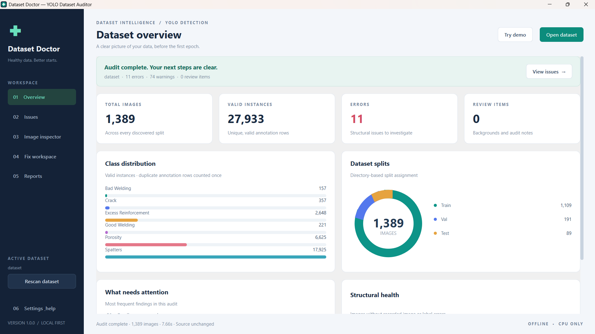
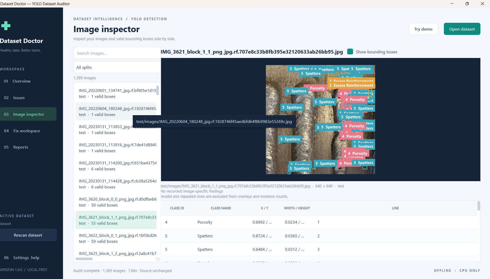
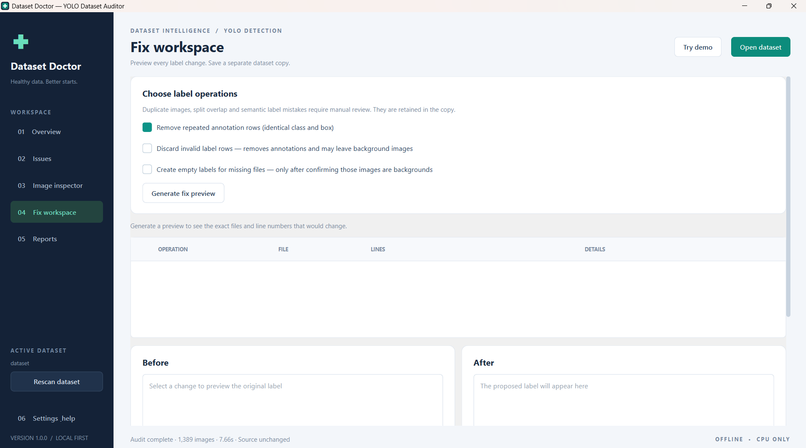
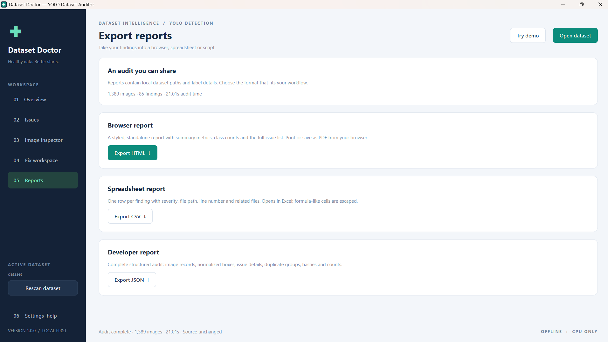

<div align="center">


# Dataset Doctor

**Healthy data. Better starts.**

A polished, local-first desktop auditor for YOLO object-detection datasets.
Find dataset mistakes before spending hours training a model.


</div>

## Screenshots

Captured on Windows while auditing a welding-defect detection dataset. The populated overview shows **1,389 images**, **27,933 valid annotation instances** and **85 findings**. Scan time varies with hardware and image size.

### Dataset overview



### Image inspector

Browse images and inspect their valid bounding boxes, class names and label rows.



### Fix workspace

Select label operations and generate a preview before saving a separate copy.



### Report exports



The screenshots demonstrate the running Windows interface. They do not imply that every fix operation has been manually tested. The real welding dataset is not included; the repository includes a small synthetic demo.

## Start on Windows

1. Install **Python 3.11 or 3.12** from [python.org](https://www.python.org/downloads/). Enable **Add Python to PATH** during installation.
2. Extract this ZIP completely to a folder such as `Desktop\DatasetDoctor`. Do not run inside the ZIP viewer.
3. Double-click **`setup_windows.bat`** once. Internet is required to download dependencies.
4. Double-click **`run_app.bat`**.
5. Click **Try demo** to explore the bundled dataset, then **Open dataset** for your own files.

After setup, all auditing and reporting work offline. No GPU, trained weights, cloud account or model training is required. This is a Python source project, not a prebuilt Windows EXE.

For your PPE dataset, choose the root folder that contains `data.yaml`, `train`, `valid` and `test`, for example:

```text
C:\Datasets\my_yolo_dataset
```

If the YAML is missing, open **Settings & help** and enter the class names in ID order before scanning:

```text
Safety-Helmet, Reflective-Jacket
```

Only use this order if it matches the IDs in your annotations.

## Inside the application

| Workspace | What you can do |
|---|---|
| Overview | See image and valid instance counts, errors, review items, class bars, split chart and the most frequent findings |
| Issues | Search file paths and messages; filter by severity, check and split; inspect a finding's related image |
| Image inspector | Browse images and display valid boxes with class names, normalized coordinates and source line numbers |
| Fix workspace | Choose operations, preview exact label rows before/after, and create a separate dataset copy |
| Reports | Export a styled standalone HTML report, Excel-readable CSV findings or a full JSON audit |
| Settings & help | Override class names and review layout, scope and privacy information |

The interface uses a dark navigation rail, light cards, teal actions, color-coded findings and custom-painted charts. Folder selection is native; you can also drag a dataset folder into the window. Scans and dataset copies run in a background worker with progress and cancellation.

## Checks

| Check | Behavior |
|---|---|
| Missing labels | Warning: a missing label may be an intentional background; it is never silently filled |
| Missing images | Orphan label warning |
| Invalid class IDs | Error for non-integer, negative or out-of-range IDs |
| Malformed label rows | Error unless the row has exactly five detection values |
| Invalid boxes | Error for non-finite values, invalid normalized ranges, non-positive dimensions or edges outside the image |
| Corrupt images | Full Pillow verification and decoding; unreadable and oversized images are flagged |
| Duplicate images | SHA-256 of decoded RGB pixels and dimensions; catches identical pixels in different lossless formats |
| Repeated annotations | Warning for identical class and box rows; duplicate rows do not inflate instance counts |
| Class imbalance | Warning when the largest/smallest nonzero instance counts differ by at least 5×; unused classes are flagged separately |
| Split overlap | Error when identical content crosses recognized train, validation or test directories |
| Annotation conflicts | Warning if duplicate images have different valid annotation sets |
| Metadata and pairing | Config errors, `nc` mismatch, ambiguous image stems, case collisions and skipped symlinks are reported |
| Empty labels | **Review item**, not an error; can represent a valid background image |

Instance counts exclude invalid rows and repeated valid rows. They can include valid labels belonging to an unreadable image; inspect image errors separately.

**Structural health** is the percentage of discovered images without recorded image/label errors. Cross-split overlap marks every affected image. Dataset-level config errors, warnings and review items are not part of this ratio, so even 100% does not mean the dataset is ready for training. It is never a model accuracy estimate.

## Dataset layouts

The selected folder should contain class metadata and one of these structures. Nested folders are supported.

```text
dataset/                       dataset/
  data.yaml                      data.yaml
  train/                         images/
    images/                        train/
    labels/                        val/
  valid/                         labels/
    images/                        train/
    labels/                        val/
  test/
    images/
    labels/
```

Flat folders with matching `image.jpg` and `image.txt` are supported too. `val`, `valid` and `validation` normalize to `val`. Image and label relative stems must match. Supported extensions: JPG, JPEG, PNG, BMP, WEBP, TIF and TIFF, case-insensitively.

Class metadata is read from the first existing file in this order: `data.yaml`, `data.yml`, `dataset.yaml`, `dataset.yml`. `names` can be a list or an integer-keyed mapping beginning at 0. Names must be unique. A manual override is also recorded as a review item.

**Scope:** this version discovers files inside the chosen folder and infers splits from directory names. YAML is used for class metadata; custom YAML split paths, absolute paths to external data and text-file image manifests are not resolved. Do not use an audit of a folder as proof that a custom training config points to the same files. Classification, polygons/segmentation, keypoints and oriented boxes are outside this version's scope. Near duplicates, JPEG re-encodings and incorrect object identity still need human review. Multi-frame images are inspected as their first frame; alpha is discarded for RGB duplicate comparison. Duplicate hashes are accumulated per image, not via pairwise comparisons.

## Safe fix workflow

1. Audit the source.
2. In **Fix workspace**, leave repeated-row removal selected or choose the other operations explicitly.
3. Click **Generate fix preview** and inspect the affected paths, source line numbers and before/after label contents.
4. Choose a **new folder outside the source dataset**.
5. Click **Create cleaned copy** and review the confirmation.
6. Open the output folder and run another audit. Resolve remaining issues before training.

Only repeated annotation removal is selected by default. **Discard invalid rows** removes annotations; a file can become an empty background. **Create empty labels** is appropriate only after you confirm missing-label images contain no target objects. Neither operation repairs the semantic meaning of a label. Duplicate images, split overlap, corrupted images and class imbalance are retained for manual review.

The output copies the audited images and label files, preserves their relative structure, regenerates `data.yaml` with the audited class names and relative split directories, and writes an operation manifest under `.dataset_doctor/`. Other metadata files are not copied. The `path` YAML key is omitted so the YAML parent can be used as the dataset base; pass the **absolute path to the generated YAML** to your training tool and verify its path interpretation. Missing/unassigned splits require manual configuration. Existing output folders are rejected. Source fingerprint changes invalidate the plan. Failed or cancelled operations remove the temporary output. Source files are never rewritten.

Images are kept even if their only annotation rows were removed. You must review them. Ambiguous file pairs, case collisions, unreadable labels/directories and symlinks block copying until resolved.

## Reports

- **HTML:** metrics, class counts and every finding; no external styles or scripts. Open in a browser and use **Print / Save PDF** if needed.
- **CSV:** one row per issue; UTF-8 BOM for Excel; formula-like cells are escaped. This is CSV, not a native `.xlsx` workbook.
- **JSON:** complete image records, valid annotations, fingerprints, duplicate groups and issue details; `schema_version: 1`.

Reports are saved outside the source dataset. They contain local file paths; review them before sharing. A sample HTML audit is included in `docs/demo_audit.html`.

## Manual setup / Linux / macOS

```bash
python3 -m venv .venv
# Windows: .venv\Scripts\activate
source .venv/bin/activate
python -m pip install -r requirements.txt
python main.py
# Open the demo directly:
python main.py --demo
```

On Windows Command Prompt after setup:

```bat
.venv\Scripts\python.exe main.py
.venv\Scripts\python.exe main.py --demo
```

See [Troubleshooting](docs/TROUBLESHOOTING.md) for dependency or Qt platform errors. Python 3.10+ is required; 3.11/3.12 is the recommended setup. Actual dependency availability depends on your OS and Python version.

## Command-line mode

The engine can run without Qt. Install only Pillow and PyYAML for headless use:

```bash
python -m pip install "Pillow>=12,<14" "PyYAML>=6.0.2,<7"
python -m dataset_doctor.cli demo_dataset
python -m dataset_doctor.cli demo_dataset --report ../audit.html
python -m dataset_doctor.cli demo_dataset --report ../audit.json
python -m dataset_doctor.cli demo_dataset --classes "Safety-Helmet,Reflective-Jacket"
python -m dataset_doctor.cli demo_dataset --clean-copy ../demo_cleaned
```

The CLI copy option removes repeated annotation rows only. It prints planned actions before copying and never edits the source. Discarding invalid rows and creating backgrounds are available in the GUI after preview.

Exit codes: `0` audit completed with no errors (warnings/reviews may remain); `1` audit completed with structural errors; `2` invalid input or an operation failure. Reports can still be written when the exit code is `1`. Report creation uses exclusive mode so an existing file is not overwritten.

## Demo and verification

The demo contains **39 synthetic illustrations** and known mistakes, including an actual empty background, a missing label, an orphan label, invalid IDs/boxes, malformed rows, an unreadable image, repeated labels, duplicates, class imbalance and a deliberate validation leak. It is a demonstration fixture, not a dataset for training PPE models.

Expected audit: **39 images, 42 unique valid instances, 6 errors, 6 warnings, 1 review item**. Classes: 37 Safety-Helmet instances and 5 Reflective-Jacket instances.

Recreate the demo into a **new** destination:

```bash
python scripts/create_demo.py ../fresh_demo
```

Run the standard-library regression suite without installing pytest:

```bash
python -m unittest discover -s tests -v
```

An optional Qt smoke test is included at `scripts/verify_ui.py`. It exercises all six pages and worker scans and saves actual UI captures when PySide6 is available:

```bash
python scripts/verify_ui.py
# Headless Linux:
QT_QPA_PLATFORM=offscreen python scripts/verify_ui.py
```

See [Validation](docs/VALIDATION.md) for the checks actually run on this release. See [Architecture](docs/ARCHITECTURE.md) for the implementation.

## Project structure

```text
DatasetDoctor/
  main.py                      Desktop entry point
  setup_windows.bat            One-time Windows setup
  run_app.bat / run_app.sh      Launchers
  dataset_doctor/
    app.py                     Six-page PySide6 interface and workers
    scanner.py                 Framework-independent auditing engine
    fixes.py                   Fix plans and transactional dataset copies
    exports.py                 HTML / CSV / JSON report generators
    widgets.py                 Charts and bounding-box preview canvas
    theme.py                   Shared desktop design system
    cli.py                     Headless audit commands
  demo_dataset/                Synthetic, intentionally imperfect dataset
  scripts/                     Demo creation and GUI smoke check
  tests/                       Engine, export and copy regression tests
  docs/                        Scope, troubleshooting, sample report
```

## Repository topics

`python` · `pyside6` · `yolo` · `computer-vision` · `dataset-validation` · `data-quality` · `desktop-application` · `machine-learning`

## Credits and license

Created for **Rupendran Manigandan**, inspired by practical dataset-cleaning problems in welding-defect and PPE detection projects.

Project code and synthetic demo assets are released under the MIT license. Dependencies retain their own licenses; PySide6/Qt distribution has its own LGPL/GPL/commercial terms. Review those terms if you later distribute a packaged executable. This ZIP contains source, not bundled Qt binaries.

Primary references: [Qt for Python](https://doc.qt.io/qtforpython-6/), [Pillow](https://pillow.readthedocs.io/en/stable/), [Ultralytics detection datasets](https://docs.ultralytics.com/datasets/detect/), [PyYAML](https://pyyaml.org/wiki/PyYAMLDocumentation).
